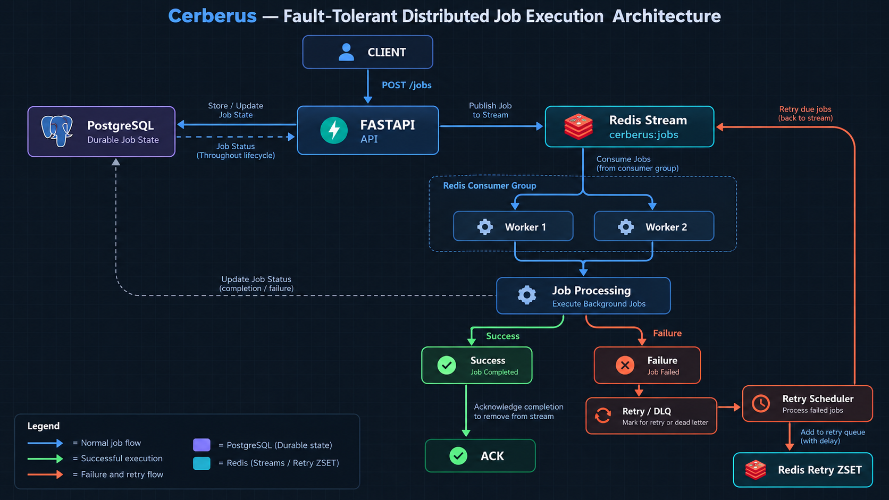

# Cerberus

> A fault-tolerant distributed job execution system built with Python, FastAPI, Redis Streams, PostgreSQL, and Prometheus.

Cerberus is a distributed background job execution system designed to reliably process asynchronous jobs even when individual workers fail.

The project focuses on practical distributed-systems concepts such as:

- Reliable job delivery
- Worker failure recovery
- Redis Streams and Consumer Groups
- Automatic job retries
- Exponential backoff with jitter
- Idempotent job processing
- Dead Letter Queues
- Durable job state using PostgreSQL
- Multi-worker execution
- Prometheus-based observability

The primary goal of Cerberus is to understand and implement the core reliability mechanisms behind distributed job-processing systems without relying on frameworks such as Celery or BullMQ.

---

## Table of Contents

- [Overview](#overview)
- [Problem Statement](#problem-statement)
- [Goals](#goals)
- [Architecture](#architecture)
- [System Workflow](#system-workflow)
- [Core Components](#core-components)
- [Job Lifecycle](#job-lifecycle)
- [Worker Failure Recovery](#worker-failure-recovery)
- [Retry Mechanism](#retry-mechanism)
- [Exponential Backoff and Jitter](#exponential-backoff-and-jitter)
- [Maximum Attempts](#maximum-attempts)
- [Idempotency](#idempotency)
- [Dead Letter Queue](#dead-letter-queue)
- [PostgreSQL and Durable State](#postgresql-and-durable-state)
- [Prometheus Monitoring](#prometheus-monitoring)
- [Project Structure](#project-structure)
- [Technology Stack](#technology-stack)
- [Installation](#installation)
- [Configuration](#configuration)
- [Running the System](#running-the-system)
- [API Documentation](#api-documentation)
- [Testing Failure Scenarios](#testing-failure-scenarios)
- [Example Job](#example-job)
- [Design Decisions](#design-decisions)
- [Current Limitations](#current-limitations)
- [Future Improvements](#future-improvements)
- [Learning Outcomes](#learning-outcomes)
- [Conclusion](#conclusion)

---

# Overview

Cerberus accepts jobs through a REST API and places them into a Redis Stream.

Workers consume jobs from the stream using Redis Consumer Groups.

If a worker successfully processes a job, the job is acknowledged.

If a worker crashes while processing a job, the job remains in the Redis Consumer Group's pending entries and can later be reclaimed by another worker using `XAUTOCLAIM`.

If a job fails during processing, Cerberus automatically schedules a retry using exponential backoff with jitter.

Jobs that continue failing beyond the maximum number of attempts are moved to a Dead Letter Queue (DLQ).

PostgreSQL maintains the durable state of each job, while Redis is responsible for job execution and coordination.

Prometheus provides application-level metrics for monitoring the system.

---

# Problem Statement

Traditional background-job systems need to handle more than simply executing a function.

A reliable job execution system must answer questions such as:

- What happens if a worker crashes?
- What happens if a job fails temporarily?
- How many times should a job be retried?
- How should retries be delayed?
- What happens when a job keeps failing?
- How can duplicate processing be prevented?
- How can job state survive application restarts?
- How can the system be monitored?

Cerberus was designed to explore and implement solutions to these problems.

---

# Goals

The main goals of Cerberus are:

1. Reliable asynchronous job execution
2. Worker failure recovery
3. Automatic retries
4. Exponential retry backoff
5. Retry jitter
6. Idempotent job processing
7. Dead Letter Queue support
8. Durable job state
9. Multiple worker support
10. Application observability

The project intentionally avoids unnecessary complexity and focuses on the core reliability mechanisms of a distributed job execution system.

---

# Architecture



The high-level architecture is:

```text
                         Client
                           |
                           | POST /jobs
                           v
                    +--------------+
                    |   FastAPI    |
                    |     API      |
                    +------+-------+
                           |
             +-------------+-------------+
             |                           |
             v                           v
       PostgreSQL                    Redis Stream
       Job State                    cerberus:jobs
                                         |
                                  +------+------+
                                  |             |
                                  v             v
                              Worker 1      Worker 2
                                  |             |
                                  +------+------+
                                         |
                                  Job Processing
                                         |
                           +-------------+-------------+
                           |                           |
                       Success                     Failure
                           |                           |
                           v                           v
                         ACK                    Retry / DLQ
                                                       |
                                                       v
                                               Retry Scheduler
                                                       |
                                                       v
                                                Redis Retry ZSET
````

---

# System Workflow

A normal job follows this lifecycle:

```text
Client
  |
  v
POST /jobs
  |
  v
FastAPI
  |
  +----> PostgreSQL
  |       Store job
  |
  +----> Redis Stream
          |
          v
       Worker
          |
          v
     Process Job
          |
          v
       Success
          |
          +----> PostgreSQL = completed
          |
          +----> Redis XACK
```

For a failed job:

```text
Worker
   |
   v
Processing
   |
   v
Failure
   |
   v
PostgreSQL = failed
   |
   v
Retry scheduled
   |
   v
Redis Retry ZSET
   |
   v
Retry Scheduler
   |
   v
Redis Stream
   |
   v
Worker
```

If the job continues failing:

```text
Failure
   |
   v
Retry
   |
   v
Retry
   |
   v
...
   |
   v
Maximum Attempts Reached
   |
   v
Dead Letter Queue
```

---

# Core Components

## 1. FastAPI

FastAPI provides the HTTP API used to submit jobs.

The main endpoint is:

```text
POST /jobs
```

The API:

1. Generates a unique job ID.
2. Stores the job in PostgreSQL.
3. Adds the job to the Redis Stream.
4. Returns the job ID and stream ID.

FastAPI also exposes the Prometheus metrics endpoint:

```text
GET /metrics
```

---

## 2. Redis Streams

Redis Streams are used as the job transport mechanism.

The main stream is:

```text
cerberus:jobs
```

A stream entry contains information such as:

```text
job_id
type
payload
attempt
```

Redis Streams provide persistent stream entries and support consumer groups, making them suitable for coordinating multiple workers.

---

## 3. Redis Consumer Groups

Workers operate as members of the Redis Consumer Group:

```text
cerberus-workers
```

Example:

```text
cerberus-workers
    |
    +-- worker-1
    |
    +-- worker-2
    |
    +-- worker-3
```

The consumer group allows multiple workers to consume jobs from the same stream.

Each worker has its own consumer name.

Example:

```bash
python -m app.worker worker-1
```

Another worker can be started with:

```bash
python -m app.worker worker-2
```

---

## 4. Job Acknowledgement

After successfully processing a job, the worker acknowledges the Redis Stream entry using `XACK`.

Conceptually:

```text
Job received
     |
     v
Process job
     |
     v
Success
     |
     v
XACK
```

Acknowledgement tells Redis that the worker has successfully handled the stream entry.

If the worker crashes before acknowledging the job, the job remains pending.

---

# Job Lifecycle

A successful job follows:

```text
queued
   |
   v
processing
   |
   v
completed
```

A temporarily failing job follows:

```text
queued
   |
   v
processing
   |
   v
failed
   |
   v
retry scheduled
   |
   v
processing
   |
   v
completed
```

A permanently failing job follows:

```text
queued
   |
   v
processing
   |
   v
failed
   |
   v
retry
   |
   v
failed
   |
   v
...
   |
   v
dead_letter
```

---

# Worker Failure Recovery

One of the most important features of Cerberus is worker crash recovery.

Consider:

```text
Worker 1
   |
   v
Receives Job A
   |
   v
Starts processing
   |
   X
Worker crashes
```

Because the worker did not acknowledge the job, Redis keeps the entry in the Pending Entries List.

Another worker can identify sufficiently idle pending jobs and reclaim them using:

```text
XAUTOCLAIM
```

The recovery flow becomes:

```text
Worker 1
   |
   X
Crash
   |
   v
Pending Job
   |
   v
XAUTOCLAIM
   |
   v
Worker 2
   |
   v
Process Job
```

This prevents a worker crash from permanently losing the job.

---

# Retry Mechanism

A job can fail even when the worker itself is healthy.

For example:

* Temporary database failure
* Temporary network failure
* External service failure
* Application-level failure

Cerberus therefore supports automatic retries.

When a job fails:

1. The failure is recorded.
2. The attempt count is updated.
3. The job is scheduled for retry.
4. The retry scheduler waits until the retry time.
5. The job is added back to the Redis Stream.
6. Another worker can process the job again.

---

# Retry Sorted Set

Retries are stored in a Redis Sorted Set:

```text
cerberus:retries
```

The score represents the time at which the job should become eligible for retry.

Conceptually:

```text
cerberus:retries

job-A    → retry at 10:00:05
job-B    → retry at 10:00:10
job-C    → retry at 10:00:15
```

The retry scheduler periodically checks this sorted set and moves jobs whose retry time has arrived back into the main Redis Stream.

---

# Exponential Backoff and Jitter

Cerberus uses exponential backoff for retries.

Instead of retrying immediately after every failure, the delay increases with each attempt.

Conceptually:

```text
Attempt 1 → short delay
Attempt 2 → longer delay
Attempt 3 → even longer delay
Attempt 4 → longer again
```

A typical exponential backoff strategy can be represented as:

```text
delay = base_delay × 2^attempt
```

Cerberus also adds jitter.

Jitter introduces a small random variation to the retry delay.

This helps avoid multiple jobs retrying at exactly the same time.

Conceptually:

```text
Without jitter:

Job A ───── retry at 10:00:10
Job B ───── retry at 10:00:10
Job C ───── retry at 10:00:10


With jitter:

Job A ───── retry at 10:00:09.8
Job B ───── retry at 10:00:10.2
Job C ───── retry at 10:00:10.5
```

This reduces synchronized retry bursts.

---

# Maximum Attempts

Cerberus limits the number of attempts for a job.

The current maximum is:

```text
MAX_ATTEMPTS = 5
```

Once the maximum number of attempts is reached, the system stops retrying the job.

The job is instead moved to the Dead Letter Queue.

---

# Idempotency

Distributed systems can sometimes process the same job more than once.

For example:

```text
Worker receives job
       |
       v
Job processing succeeds
       |
       X
Worker crashes before ACK
       |
       v
Another worker receives the same job
```

Without idempotency, the operation could potentially execute twice.

Cerberus uses an idempotency key based on the job ID.

The key format is:

```text
cerberus:processed:<job_id>
```

Before processing a job, the worker checks whether it has already been processed.

Conceptually:

```text
              Job
               |
               v
       Already processed?
          /          \
        YES           NO
        |              |
        v              v
      ACK           Process
                       |
                       v
                 Mark processed
                       |
                       v
                      ACK
```

This provides protection against duplicate processing in scenarios where a job can be delivered again.

---

# Dead Letter Queue

Some jobs may continue failing despite retries.

Retrying such jobs forever is undesirable.

Cerberus therefore provides a Dead Letter Queue.

The DLQ stream is:

```text
cerberus:dlq
```

The lifecycle is:

```text
Job
 |
 v
Attempt 1
 |
Failure
 |
 v
Retry
 |
 v
Attempt 2
 |
Failure
 |
 v
Retry
 |
 v
...
 |
 v
Maximum Attempts Reached
 |
Failure
 |
 v
DLQ
```

When a job is moved to the DLQ:

* PostgreSQL is updated to `dead_letter`
* The job is added to the DLQ Redis Stream
* The job is acknowledged from the original stream
* The DLQ metric is incremented

This prevents endlessly retrying permanently failing jobs.

---

# PostgreSQL and Durable State

Redis is responsible for job execution and coordination.

PostgreSQL is used for the durable state of each job.

The `jobs` table stores information such as:

```text
job_id
job_type
payload
status
attempts
created_at
updated_at
```

Example lifecycle:

```text
queued
   ↓
processing
   ↓
completed
```

For failures:

```text
queued
   ↓
processing
   ↓
failed
   ↓
retry
   ↓
processing
   ↓
completed
```

For permanently failing jobs:

```text
queued
   ↓
processing
   ↓
failed
   ↓
retry
   ↓
...
   ↓
dead_letter
```

This separation gives Cerberus two distinct responsibilities:

```text
Redis
→ Job execution and coordination

PostgreSQL
→ Durable job state
```

---

# Prometheus Monitoring

Cerberus exposes application metrics through:

```text
GET /metrics
```

The metrics are generated using the Prometheus Python client.

The following application metrics are currently tracked:

| Metric                              | Description                       |
| ----------------------------------- | --------------------------------- |
| `cerberus_jobs_submitted_total`     | Total jobs successfully submitted |
| `cerberus_jobs_completed_total`     | Total jobs completed successfully |
| `cerberus_jobs_failed_total`        | Total job processing failures     |
| `cerberus_jobs_retried_total`       | Total retries scheduled           |
| `cerberus_jobs_dead_lettered_total` | Total jobs moved to DLQ           |

Example:

```text
cerberus_jobs_submitted_total 4.0
cerberus_jobs_completed_total 3.0
cerberus_jobs_failed_total 11.0
cerberus_jobs_retried_total 9.0
cerberus_jobs_dead_lettered_total 2.0
```

These metrics make it possible to observe the behavior of the job-processing system.

---

# Multi-Process Prometheus Metrics

FastAPI and workers run as separate Python processes.

A normal in-memory Prometheus counter belongs to the process that created it.

Therefore, Cerberus uses the Prometheus Python client's multiprocess mode.

The environment variable:

```text
PROMETHEUS_MULTIPROC_DIR
```

points to the directory used to share metric data between processes.

The `/metrics` endpoint uses a dedicated `CollectorRegistry` together with `MultiProcessCollector`.

This allows metrics generated by the API and worker processes to be combined when `/metrics` is requested.

The architecture is:

```text
FastAPI Process
    |
    +── jobs_submitted

Worker Process
    |
    +── jobs_completed
    +── jobs_failed
    +── jobs_retried
    +── jobs_dead_lettered

             |
             v
   PROMETHEUS_MULTIPROC_DIR
             |
             v
        /metrics
             |
             v
      Combined Metrics
```

This was tested successfully using separate FastAPI and worker processes.

---

# Redis Keys and Streams

Cerberus uses the following Redis structures:

| Redis Key                     | Type           | Purpose                  |
| ----------------------------- | -------------- | ------------------------ |
| `cerberus:jobs`               | Stream         | Main job queue           |
| `cerberus:retries`            | Sorted Set     | Stores scheduled retries |
| `cerberus:dlq`                | Stream         | Dead Letter Queue        |
| `cerberus:processed:<job_id>` | Key            | Idempotency tracking     |
| `cerberus-workers`            | Consumer Group | Worker coordination      |

---

# Technology Stack

| Technology        | Purpose                                                    |
| ----------------- | ---------------------------------------------------------- |
| Python            | Core application and worker implementation                 |
| FastAPI           | REST API                                                   |
| Redis             | Job queue, streams, consumer groups and retry coordination |
| PostgreSQL        | Durable job state                                          |
| Prometheus Client | Application metrics                                        |
| Docker            | Planned containerization                                   |
| Git/GitHub        | Version control and project management                     |

---

# Project Structure

```text
Cerberus/
│
├── app/
│   ├── main.py
│   ├── worker.py
│   ├── retry_scheduler.py
│   ├── postgres_client.py
│   ├── redis_client.py
│   ├── metrics.py
│   └── models.py
│
├── .env
├── .gitignore
├── requirements.txt
└── README.md
```

### `main.py`

Contains the FastAPI application and job submission endpoint.

Responsibilities:

* Accept job requests
* Generate job IDs
* Store jobs in PostgreSQL
* Add jobs to Redis Streams
* Expose Prometheus metrics

---

### `worker.py`

Contains the worker implementation.

Responsibilities:

* Join the Redis Consumer Group
* Consume jobs
* Process jobs
* Acknowledge successful jobs
* Detect failures
* Schedule retries
* Move permanently failing jobs to the DLQ
* Perform idempotency checks
* Reclaim abandoned jobs using `XAUTOCLAIM`

---

### `retry_scheduler.py`

Responsible for processing scheduled retries.

Responsibilities:

* Monitor `cerberus:retries`
* Identify jobs whose retry time has arrived
* Reinsert them into the main Redis Stream

---

### `postgres_client.py`

Handles PostgreSQL operations.

Responsibilities:

* Create job records
* Update job status
* Update attempt counts
* Maintain timestamps

---

### `redis_client.py`

Contains Redis connection configuration and client initialization.

---

### `metrics.py`

Defines the Prometheus application metrics.

Current metrics include:

```text
cerberus_jobs_submitted_total
cerberus_jobs_completed_total
cerberus_jobs_failed_total
cerberus_jobs_retried_total
cerberus_jobs_dead_lettered_total
```

---

### `models.py`

Contains the request models used by the FastAPI application.

---

# Installation

## Prerequisites

Install the following:

* Python 3.10+
* PostgreSQL
* Redis
* Git

Optional:

* Docker
* Docker Compose

Docker support is planned separately and is tracked as a GitHub issue.

---

# Clone the Repository

```bash
git clone <your-repository-url>
cd Cerberus
```

---

# Create a Virtual Environment

### Windows

```powershell
python -m venv .venv
```

Activate it:

```powershell
.venv\Scripts\Activate.ps1
```

---

# Install Dependencies

```bash
pip install -r requirements.txt
```

---

# PostgreSQL Setup

Create a PostgreSQL database named:

```text
cerberus
```

Create the `jobs` table with the required fields:

```sql
CREATE TABLE jobs (
    job_id UUID PRIMARY KEY,
    job_type VARCHAR(100) NOT NULL,
    payload JSONB NOT NULL,
    status VARCHAR(50) NOT NULL,
    attempts INTEGER DEFAULT 0,
    created_at TIMESTAMP DEFAULT CURRENT_TIMESTAMP,
    updated_at TIMESTAMP DEFAULT CURRENT_TIMESTAMP
);
```

---

# Environment Configuration

Create a `.env` file in the project root.

Example:

```env
POSTGRES_HOST=localhost
POSTGRES_PORT=5432
POSTGRES_DB=cerberus
POSTGRES_USER=postgres
POSTGRES_PASSWORD=your_password

REDIS_HOST=localhost
REDIS_PORT=6379
```

Do not commit real passwords or secrets to GitHub.

Make sure `.env` is included in `.gitignore`.

---

# Running the System

Cerberus currently consists of three application processes:

```text
FastAPI
Worker
Retry Scheduler
```

Redis and PostgreSQL must also be running.

---

## 1. Start FastAPI

From the project root:

```bash
uvicorn app.main:app
```

The API will be available at:

```text
http://127.0.0.1:8000
```

---

## 2. Start a Worker

Open another terminal.

From the project root:

```bash
python -m app.worker worker-1
```

A second worker can be started with:

```bash
python -m app.worker worker-2
```

This allows multiple workers to participate in the same consumer group.

---

## 3. Start the Retry Scheduler

Open another terminal:

```bash
python -m app.retry_scheduler
```

The scheduler is responsible for moving eligible retry jobs back into the main Redis Stream.

---

# Prometheus Multi-Process Setup

When running FastAPI and workers as separate processes, set:

```powershell
$env:PROMETHEUS_MULTIPROC_DIR="$PWD\.metrics"
```

Create the directory if it does not exist:

```powershell
mkdir .metrics
```

The directory should be ignored by Git:

```gitignore
.metrics/
```

Before starting a fresh test run, clear old metric files:

```powershell
Remove-Item .metrics\* -Force -ErrorAction SilentlyContinue
```

Then set the environment variable in every terminal before starting the corresponding process.

---

# API Documentation

FastAPI automatically provides interactive API documentation.

Once the server is running, open:

```text
http://127.0.0.1:8000/docs
```

The Swagger UI allows jobs to be submitted and tested without requiring an external API client.

---

# Create a Job

Endpoint:

```text
POST /jobs
```

Example request:

```json
{
  "type": "normal",
  "payload": {
    "message": "Hello Cerberus"
  }
}
```

Example response:

```json
{
  "job_id": "xxxxxxxx-xxxx-xxxx-xxxx-xxxxxxxxxxxx",
  "stream_id": "1234567890-0",
  "type": "normal",
  "payload": {
    "message": "Hello Cerberus"
  },
  "status": "queued"
}
```

---

# Job Types Used for Testing

Cerberus currently supports test job types that demonstrate different failure scenarios.

## Normal Job

```json
{
  "type": "normal",
  "payload": {
    "message": "Successful job"
  }
}
```

Expected behavior:

```text
queued
  ↓
processing
  ↓
completed
```

---

## `fail_once`

The `fail_once` job intentionally fails on its first attempt and succeeds on a later attempt.

Example:

```json
{
  "type": "fail_once",
  "payload": {
    "message": "Retry test"
  }
}
```

Expected behavior:

```text
Attempt 1
   ↓
Failure
   ↓
Retry scheduled
   ↓
Attempt 2
   ↓
Success
```

This is useful for testing the retry mechanism.

---

## `fail`

The `fail` job intentionally fails every time.

Example:

```json
{
  "type": "fail",
  "payload": {
    "message": "DLQ test"
  }
}
```

Expected behavior:

```text
Attempt 1 → Failure
Attempt 2 → Failure
Attempt 3 → Failure
Attempt 4 → Failure
Attempt 5 → Failure
                 ↓
                DLQ
```

This is useful for testing maximum attempts and Dead Letter Queue behavior.

---

# Testing Failure Scenarios

Cerberus was manually tested using Swagger, terminal logs, Redis and PostgreSQL.

---

## Test 1: Successful Job

Submit:

```json
{
  "type": "normal",
  "payload": {
    "message": "Success test"
  }
}
```

Expected:

```text
PostgreSQL → completed
Redis      → ACK
Prometheus → jobs_completed_total increases
```

---

## Test 2: Retry

Submit:

```json
{
  "type": "fail_once",
  "payload": {
    "message": "Retry test"
  }
}
```

Expected:

```text
Attempt 1
    ↓
Failure
    ↓
Retry scheduled
    ↓
Retry Scheduler
    ↓
Redis Stream
    ↓
Worker
    ↓
Success
```

Prometheus should show increases in:

```text
cerberus_jobs_failed_total
cerberus_jobs_retried_total
cerberus_jobs_completed_total
```

---

## Test 3: Dead Letter Queue

Submit:

```json
{
  "type": "fail",
  "payload": {
    "message": "DLQ test"
  }
}
```

Expected:

```text
Attempt 1 → Failure
Attempt 2 → Failure
Attempt 3 → Failure
Attempt 4 → Failure
Attempt 5 → Failure
     ↓
Dead Letter Queue
```

Prometheus should show:

```text
cerberus_jobs_dead_lettered_total
```

increasing.

PostgreSQL should show:

```text
status = dead_letter
```

---

## Test 4: Worker Crash Recovery

Start at least two workers:

```bash
python -m app.worker worker-1
```

```bash
python -m app.worker worker-2
```

Submit a job.

During processing, terminate one worker.

The job should remain pending in Redis.

The remaining worker can reclaim the job using:

```text
XAUTOCLAIM
```

Expected flow:

```text
Worker 1
   |
   X
Crash
   |
   v
Pending Entry
   |
   v
XAUTOCLAIM
   |
   v
Worker 2
   |
   v
Job processed
```

This demonstrates worker failure recovery.

---

# Design Decisions

## Why Redis Streams?

Redis Streams were selected because they provide:

* Persistent stream entries
* Consumer groups
* Message acknowledgement
* Pending entry tracking
* Consumer-level ownership
* `XAUTOCLAIM` for recovering abandoned jobs

This makes Redis Streams a good fit for implementing a reliable job queue while learning the underlying mechanisms.

---

## Why Consumer Groups?

Consumer groups allow multiple workers to share the workload.

Instead of every worker processing every job:

```text
Job A → Worker 1
Job B → Worker 2
Job C → Worker 3
```

the consumer group distributes work across workers.

---

## Why PostgreSQL?

Redis is excellent for fast job coordination, but PostgreSQL provides durable structured state.

PostgreSQL acts as the persistent record of:

* Job status
* Attempts
* Payload
* Creation time
* Update time

This separation keeps execution coordination and durable state distinct.

---

## Why Not Celery or BullMQ?

Cerberus intentionally implements the core mechanisms directly.

Using an existing job framework would hide many of the concepts this project is designed to demonstrate.

The project therefore implements:

* Queueing
* Consumer groups
* Acknowledgement
* Retry scheduling
* Backoff
* Jitter
* Failure recovery
* Idempotency
* DLQ

directly using Redis and Python.

---

## Why No Worker Heartbeat?

A worker heartbeat mechanism was considered but intentionally not included.

Redis Streams already provide pending-entry tracking, and Cerberus uses `XAUTOCLAIM` to recover jobs that have remained idle for a configured period.

The project therefore focuses on job-level recovery rather than introducing a separate worker-liveness subsystem.

---

## Why No React Dashboard?

A separate React dashboard was considered but intentionally excluded from the core project.

Prometheus metrics are exposed through:

```text
/metrics
```

This keeps the project focused on the distributed job execution system rather than frontend development.

---

# Current Limitations

Cerberus is a learning and portfolio project and therefore has several limitations.

### 1. No Authentication

The API currently does not implement user authentication or authorization.

### 2. No Production Deployment

The project currently focuses on local development and demonstration.

### 3. No Full Prometheus Server / Grafana Stack

Application metrics are exposed through `/metrics`, but a complete Prometheus + Grafana monitoring stack is not currently included.

### 4. No Automated Test Suite

The project was primarily tested manually using:

* Swagger
* Redis
* PostgreSQL
* Worker logs
* Prometheus metrics

An automated test suite can be added later.

### 5. No Worker Heartbeat

Worker liveness is inferred through pending Redis Stream entries and `XAUTOCLAIM`.

### 6. No Web Dashboard

There is currently no dedicated React dashboard.

---

# Future Improvements

The following improvements can be added in future iterations.

## Docker and Docker Compose

Tracked separately as a GitHub issue.

The planned architecture is:

```text
Docker Compose
      |
      +-- FastAPI
      +-- Worker
      +-- Retry Scheduler
      +-- Redis
      +-- PostgreSQL
```

The goal is to start the complete system using:

```bash
docker compose up --build
```

---

## Automated Testing

Add a comprehensive test suite using `pytest`.

Potential test cases:

* Job creation
* Successful processing
* Retry behavior
* Exponential backoff
* Jitter
* Maximum attempts
* DLQ behavior
* Idempotency
* Worker crash recovery

---

## Prometheus + Grafana

A complete monitoring stack could be added:

```text
Cerberus
    |
    v
Prometheus
    |
    v
Grafana
```

This would allow dashboards for:

* Job throughput
* Failure rate
* Retry rate
* DLQ rate
* Processing latency
* Worker activity

---

## Job Priorities

Jobs could support priority levels such as:

```text
high
medium
low
```

---

## Scheduled Jobs

Support jobs that execute at a specified future time.

---

## Job Cancellation

Add an API endpoint for cancelling jobs that have not yet started.

---

## Horizontal Scaling

Run multiple worker instances to increase processing throughput.

For example:

```text
            Redis
              |
      +-------+-------+
      |       |       |
   Worker 1 Worker 2 Worker 3
```

---

# Learning Outcomes

Building Cerberus provided practical experience with several distributed-systems concepts.

## Redis

* Redis Streams
* Consumer Groups
* Pending Entries
* `XACK`
* `XAUTOCLAIM`
* Sorted Sets
* Retry scheduling

## Distributed Systems

* Worker failure recovery
* At-least-once delivery concepts
* Duplicate processing
* Idempotency
* Retry strategies
* Backoff
* Jitter
* Dead Letter Queues
* Multi-worker coordination

## Backend Development

* FastAPI
* REST APIs
* Request validation
* Background processing
* PostgreSQL integration

## Observability

* Prometheus counters
* Application metrics
* Multi-process metric collection
* Monitoring job execution behavior

## Software Engineering

* Modular project structure
* Git version control
* Incremental development
* Failure-oriented testing
* System design

---

# Git Development Approach

Cerberus was developed incrementally, with major features committed as separate checkpoints.

The development focused on implementing and validating each reliability mechanism before moving to the next one.

Major milestones included:

```text
FastAPI Job Submission
        ↓
Redis Streams
        ↓
Consumer Groups
        ↓
Multiple Workers
        ↓
Acknowledgement
        ↓
Worker Crash Recovery
        ↓
Retries
        ↓
Exponential Backoff
        ↓
Retry Jitter
        ↓
Maximum Attempts
        ↓
Dead Letter Queue
        ↓
Idempotency
        ↓
PostgreSQL State
        ↓
Prometheus Metrics
        ↓
Multi-Process Metrics
```

This approach made it easier to isolate problems and verify each distributed-system concept independently.

---

# Project Status

## Completed

* [x] FastAPI job submission
* [x] Redis Streams
* [x] Redis Consumer Groups
* [x] Multiple workers
* [x] Job acknowledgement
* [x] Pending job handling
* [x] Worker crash recovery
* [x] `XAUTOCLAIM`
* [x] Automatic retries
* [x] Retry scheduler
* [x] Exponential backoff
* [x] Retry jitter
* [x] Maximum attempts
* [x] Dead Letter Queue
* [x] Idempotency
* [x] PostgreSQL durable state
* [x] Job status tracking
* [x] Attempt tracking
* [x] Prometheus metrics
* [x] Multi-process Prometheus metrics
* [x] Successful job testing
* [x] Retry testing
* [x] DLQ testing
* [x] Worker failure recovery testing

## Planned

* [ ] Dockerfile
* [ ] Docker Compose
* [ ] Containerized Redis
* [ ] Containerized PostgreSQL
* [ ] Containerized FastAPI
* [ ] Containerized workers
* [ ] Containerized retry scheduler
* [ ] Automated tests
* [ ] Grafana dashboard

---

# Conclusion

Cerberus is a fault-tolerant distributed job execution system designed to explore how reliable background processing systems work internally.

The project demonstrates how multiple technologies can be combined to provide reliable asynchronous job processing:

```text
                    +----------------+
                    |    FastAPI     |
                    +-------+--------+
                            |
                            v
                    +---------------+
                    | Redis Stream  |
                    +-------+-------+
                            |
                  +---------+---------+
                  |                   |
                  v                   v
             Worker 1             Worker 2
                  |                   |
                  +---------+---------+
                            |
                 +----------+----------+
                 |                     |
              Success                Failure
                 |                     |
                ACK               Retry / DLQ
                                       |
                                       v
                               Retry Scheduler
                                       |
                                       v
                                  Redis ZSET


                    PostgreSQL
                         ^
                         |
                    Job State


                    Prometheus
                         ^
                         |
                      /metrics
```

The key reliability mechanisms implemented by Cerberus are:

```text
Redis Streams
      +
Consumer Groups
      +
Acknowledgements
      +
XAUTOCLAIM
      +
Retries
      +
Exponential Backoff
      +
Jitter
      +
Idempotency
      +
Dead Letter Queue
      +
PostgreSQL
      +
Prometheus
```

Together, these mechanisms allow Cerberus to continue processing jobs despite worker failures, transient errors, duplicate deliveries, and permanently failing jobs.

The project serves as a practical exploration of distributed job processing, fault tolerance, reliability engineering, and backend system design.
